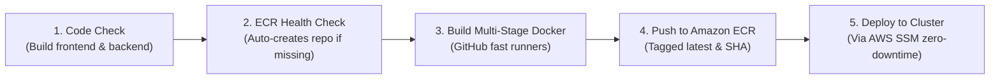

# CloudScale CI/CD Pipeline Setup Guide (GitHub Actions & Amazon ECR)

This guide walks you through setting up and running your automated CI/CD pipeline using **GitHub Actions** and **Amazon ECR**.

---

## 1. What This CI/CD Pipeline Does

Every time you `git push` code to the `main` branch, the pipeline automatically:



1. **Continuous Integration (Test & Build):** Validates that backend and frontend code build without errors.
2. **Resilient Containerization (Amazon ECR):** Automatically checks if the private Amazon ECR repository exists. If your Terraform infrastructure has not been applied yet or was destroyed to save costs, **GitHub Actions creates the ECR repository automatically on the fly** with vulnerability scanning enabled!
3. **Continuous Deployment (Rolling Zero-Downtime Update):** Uses AWS Systems Manager (SSM) to tell all running EC2 instances to pull the new image and restart the container in seconds. If the cluster is currently stopped or destroyed, it safely stores the image in ECR so that any newly launched instances get it automatically on boot!

---

## 2. Step 1: Add AWS Secrets to Your GitHub Repository

To allow GitHub Actions to push images to your Amazon ECR and trigger SSM deployments, add your AWS credentials to GitHub Secrets:

1. Open your GitHub Repository in your browser:  
   👉 **`https://github.com/nayka-mihir/CloudScale/settings/secrets/actions`**
2. Click **New repository secret** (green button).
3. Add the following 3 secrets:

| Secret Name | Secret Value | Description |
|---|---|---|
| `AWS_ACCESS_KEY_ID` | `AKIA...` (Your AWS access key ID) | Used to authenticate GitHub runner with AWS |
| `AWS_SECRET_ACCESS_KEY` | `wJalrX...` (Your AWS secret access key) | AWS secret access key |
| `AWS_REGION` | `ap-southeast-2` | AWS Sydney region where CloudScale runs |

> [!TIP]
> If you already have your AWS CLI configured on your computer, you can find your access key in `C:\Users\mihir\.aws\credentials`.

---

## 3. Step 2: How to Trigger the Pipeline

There are two ways to trigger the pipeline:

### Method A: Push Any Code Change (Automatic)
Whenever you make changes to backend, frontend, or config:
```bash
git add .
git commit -m "Update frontend telemetry styling"
git push origin main
```
GitHub Actions will automatically trigger and run all 3 jobs.

### Method B: Manual Trigger from GitHub UI
1. Go to your GitHub repo -> **Actions** tab.
2. Under "All workflows", click **CloudScale CI/CD Pipeline**.
3. Click the **Run workflow** dropdown button -> click **Run workflow**.

---

## 4. Pipeline Jobs Overview

| Job | Name | What It Does |
|---|---|---|
| **Job 1** | `1. Code Integrity & Build Verification` | Sets up Node.js 20, tests backend dependencies, and compiles frontend production assets (`npm run build`). |
| **Job 2** | `2. Build & Push Image to Amazon ECR` | Authenticates with AWS, builds the multi-stage Docker container with Buildx cache, tags it with `latest` + `$GITHUB_SHA`, and pushes to Amazon ECR. |
| **Job 3** | `3. Rolling Deploy to EC2 Cluster` | Finds running instances with tag `Project=CloudScale`. Runs zero-downtime container update via AWS Systems Manager. |

---

## 5. Verifying Pipeline Runs

1. Go to: **`https://github.com/nayka-mihir/CloudScale/actions`**
2. Click on the latest workflow run to view real-time build and deployment logs.
3. Once all 3 jobs show green checkmarks (✅), your changes are live on the cloud!
